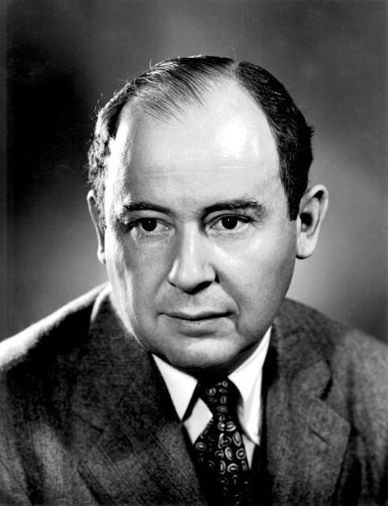
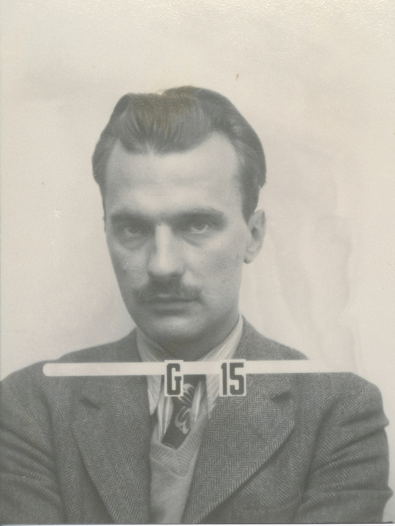
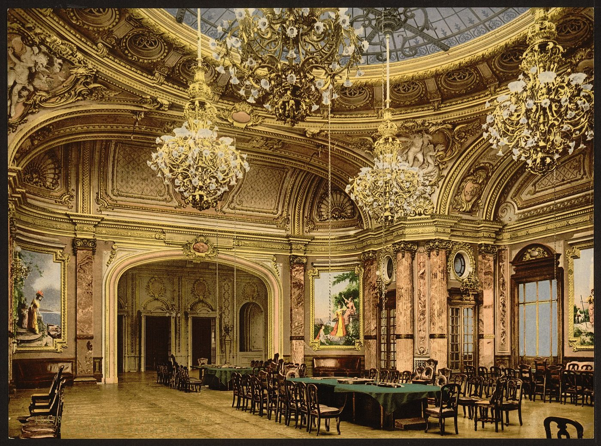

# Montecarlo e índices {#sec-montecarlo}

<!-- Seguimiento interno (no visible): primer borrador del 2026-11-27, con el esquema revisado por un agente crítico y aprobado por el autor («adelante con todo», memoria/esquemas/09-montecarlo.md, D028): Mecánicas con los tres tiempos del capítulo 7 como tabla propia de M7 (el mismo ut), beta-PERT, 10 000 réplicas, semilla 2026 y plazo de 16 días; apertura con el problema de la diagonal de la Primitiva que pusieron al autor en un examen de Estadística (exacta 680 371/13 983 816 = 0,0487, en los dos sentidos, 47 diagonales; consecutivos 0,4952; figuras 09-boleto.svg y 09-loteria.svg con figuras/09-loteria.py, semilla 2026: diagonal 0,0300 con 100 sorteos, 0,0469 con 10⁴, 0,0485 con 10⁶; consecutivos 0,4959 con 10⁶); el nombre, con Ulam y el solitario (Eckhardt, 1987, p. 131), Los Álamos y el ENIAC (Metropolis, 1987, pp. 125–128), el tío de Ulam (Metropolis, 1987, p. 127) y Metropolis y Ulam (1949, p. 336; OCR); Van Slyke (1963) como hilo histórico; criticidad (Van Slyke; Dodin y Elmaghraby) y crucialidad (Williams); la curva importa (tabla de siete curvas); Acebes et al. (2015, 2021) con poco peso; Santos et al. (2023), de los autores del libro, en [+] (pp. 10 y 12), a petición del autor; índice de significación solo en [A]. Cifras comprobadas con el núcleo de project-network-lab b6e49ee (sin cambios en core/sim y core/mc desde b42bbfc): m7.model, sim.run con track, mc.indices, mc.exact y probgen. Mecánicas: media 14,660 ± 0,030, σ 1,539, de 10,75 a 21,85; P(≤ 16) 0,813 ± 0,008 (normal 0,907); P(≤ 13) 0,138; P(≤ 14,17) 0,404; P50 14,54, P80 15,93, P90 16,69 [16,65; 16,76], P95 17,37 [17,29; 17,45]; normal 14,17, 15,33, 15,94, 16,44; comienzo medio de I 8,129 (7,667) y de K 13,660 (13,167). Réplicas 1–5: 13,70 (B E I J K), 15,57 (C G I J K: C 6,11, G 1,89, I 3,44, J 3,13), 15,68, 13,73, 13,64 (B F I J K: B 3,77, F 4,93, I 1,46, J 2,49); de las 20 primeras, 18 cumplen 16. Convergencia: 10² 14,497 ± 0,277, P 0,890 ± 0,061; 10³ 14,578 ± 0,094, 0,830 ± 0,023; 10⁴ 14,660 ± 0,030, 0,813 ± 0,008; 10⁵ 14,664 ± 0,010, 0,810 ± 0,002; semillas 1–5: P 0,806–0,816, P90 16,68–16,77. Criticidad: K 1, I y J 0,974, B 0,905, E 0,546, F 0,376, C y G 0,052, D 0,026, A 0,017, H 0; caminos B E I J K 0,529, B F I J K 0,376, C G I J K 0,052, D K 0,026, A E I J K 0,017. Crucialidad (Pearson): B 0,615, I 0,545, F 0,410, J 0,238, E 0,134, C 0,057, D 0,036, G 0,004, A −0,006, H y K 0; Spearman B 0,593. Significación: K 1, J 0,995, I 0,993, B 0,983, E 0,906, F 0,848, D 0,659, G 0,520, A 0,514, C 0,503, H 0,183. Acortar 0,1 (10⁵, misma semilla): K 0,100, I 0,097, B 0,090, E 0,053, F 0,037, C 0,005, D 0,003. F más incierta con media 3,83: (1, 3, 10) 14,837, P 0,774, crit 0,404, cruc 0,483; (0, 3, 11) 14,995, 0,736, 0,420, 0,570 (B 0,534). Curvas: beta clásica 14,585 / 0,827 / P90 16,61; triangular 16,490, σ 2,041, 0,439, 19,20, B F I J K 0,548; uniforme 18,571, 2,596, 0,163, 22,04, B F I J K 0,630; normal truncada 14,645, 1,443, 0,825, 16,53; lognormal 14,662, 1,544, 0,824, 16,68; discreta de tres puntos, exacta (19 683 combinaciones): 15,874, σ 3,151, P(≤ 16) 0,472, P90 19, B E I J K 0,613 (suma de caminos 1,266); simulación 15,804, 0,482. kd exacta: 23,248, P(≤ 20) 0,1573 (normal 0,548); criticidad 0,068, 0,320, 0,660, 0,388; caminos 0,32, 0,66, 0,068 (suma 1,048); crucialidad 0,016, 0,159, 0,584, 0,460; significación 0,603, 0,743, 0,817, 0,790. Williams exacta: (a) crit 0,99/0,01, cruc 0,005/1,000; (b) 0,504/0,862; (c) 0,990/0,102; (d) 0/1. Simulación de (a): Spearman A 0,974, B 0,209. hl: beta-PERT 44,358, 0,814; triangular 46,169, 0,600. Una actividad (3, 5, 13), plazo 6: 0,547 (exacta 0,548). Ejercicios: réplicas a mano, fácil, semilla 7 (plazo 23; T 21, 22, 23, 26, 21; P 4/5; criticidad A 2/5, B 4/5, C, D y F 1, E 0); discretas a mano, fácil, semilla 1 (plazo 27; T 27 con 0,6 y 0,2, 30 con 0,15 y 36 con 0,05; E[T] 27,9; P 0,8; criticidad de E y F 0,4); leer una simulación, fácil, semilla 1 (media 29,61; P(≤ 33) 0,910, normal 0,939; P90 32,83; criticidad de F 0,411; A más crítica y más crucial). Fuentes cotejadas: Van Slyke (1963, pp. 839, 843, 844 y 849; OCR); Dodin y Elmaghraby (1985, p. 209; OCR); Klastorin (2004, pp. 140–147 y 157; página = PDF − 22); Williams (2002, pp. 97–114 y 129–130; página = PDF − 10); Hillier y Lieberman (2001, pp. 1119–1122); Nicholas y Steyn (2012, pp. 252–255); PMI (2025, guía, pp. 197–199); Schonberger (1981, pp. 66–67); Acebes et al. (2015) y (2021), versiones previas (sin páginas; SI en la ecuación 6 de la de 2021). Notas internas, no se reproducen: la simulación de Klastorin con normales (p. 144: media 27,65, varianza 18,02, B 51 % y C 40 %) no casa con el portal (normales truncadas, 10⁴: 24,53 ± 0,05, C 0,575, B 0,392); Klastorin (p. 146) remite a la «figura 6.10» para la distribución de las 100 réplicas, que es la 6.12. -->

**Portal:** [Project Network Lab](https://josemagalan.github.io/project-network-lab/), pestaña [Duraciones inciertas](https://josemagalan.github.io/project-network-lab/cpm.html?lang=es#v=unc&um=m7), apartado «Montecarlo e índices (M7)», y pestaña [Ejercicios](https://josemagalan.github.io/project-network-lab/cpm.html?lang=es#v=ex&xk=mc) (Montecarlo).

::: {.callout-warning .objetivos title="Objetivos del capítulo"}
Al terminar el recorrido básico de este capítulo podrás:

- explicar qué es simular una red y hacer unas cuantas réplicas a mano;
- leer el histograma, la función de distribución y los percentiles de una simulación, y elegir un plazo para una probabilidad;
- dar el error de una estimación y decidir cuántas réplicas hacen falta;
- calcular e interpretar la criticidad de actividades y caminos y la crucialidad, y saber para qué sirve cada una;
- comprobar que la curva que se elige para cada actividad cambia la respuesta.
:::

## Simular una red [[Básico]{.largo}[B]{.corto}]{.nivel .basico} {#sec-mc-simular}

### Un problema de examen

Para quien no la conozca: la Primitiva es una lotería pública española, con sorteos varios días a la semana. En cada sorteo se sacan de un bombo, al azar, 6 bolas distintas de las 49 que hay, numeradas del 1 al 49; aparte se sortean un número complementario y el reintegro, que aquí no cuentan. Quien juega marca 6 números en un bloque del boleto y gana un premio si acierta al menos tres; acertar los seis es una posibilidad entre C(49, 6) = 13 983 816. En el bloque, los números están colocados en una cuadrícula de diez filas y cinco columnas (figura -@fig-mc-boleto).

Al primer autor de este libro le pusieron este problema, cuando era estudiante, en un examen de Estadística. ¿Con qué probabilidad tres de los seis números que salen forman una diagonal de tres casillas, en un sentido o en el otro, como 11, 22 y 33 o 27, 36 y 45?

{#fig-mc-boleto fig-alt="Cuadrícula de diez filas y cinco columnas con los números del 1 al 49: la primera columna, del 1 al 9; la segunda, del 10 al 19; y así hasta la quinta, del 40 al 49; la casilla de arriba a la izquierda está vacía. En azul, 11, 22 y 33, en diagonal hacia abajo y a la derecha. En naranja, 27, 36 y 45, en diagonal hacia arriba y a la derecha." width=40%}

Él y casi todos sus compañeros empezaron a encadenar probabilidades condicionadas, y enseguida vieron que el problema era extremadamente difícil: hay 47 diagonales posibles, muchas comparten casillas, unas casillas están en más diagonales que otras y seis números pueden formar más de una. La respuesta que se esperaba no era una fórmula, sino una forma de aproximar el resultado: escribir un programa que sortee seis números, compruebe si forman una diagonal y lo repita muchas veces.

```
aciertos ← 0
repetir N veces:
    sacar 6 números distintos entre 1 y 49
    si tres de ellos forman una diagonal del boleto:
        aciertos ← aciertos + 1
probabilidad ≈ aciertos / N
```

Comprobar si hay una diagonal es fácil. El número n está en la fila de sus unidades y en la columna de sus decenas: 27 está en la fila 7 y la columna 2. Una diagonal hacia abajo y a la derecha es n, n + 11 y n + 22; una hacia arriba y a la derecha, n, n + 9 y n + 18, siempre que las tres casillas estén en la cuadrícula. Con un millón de sorteos simulados, la proporción de sorteos con diagonal es 0,0485. El valor exacto, que se puede calcular haciendo que un ordenador recorra las 13 983 816 combinaciones posibles, es 0,0487: casi 5 sorteos de cada 100. Lo que a mano era casi imposible se aproxima con unas pocas líneas de código.

### El nombre: Montecarlo

Es lo mismo que le pasó a Stanislaw Ulam en 1946. Mientras se recuperaba de una enfermedad jugando a los solitarios, se preguntó con qué probabilidad sale un solitario. Después de mucho tiempo intentando calcularla con combinatoria, pensó que sería más práctico jugarlo, por ejemplo, cien veces y contar cuántas salían. Enseguida vio que los nuevos ordenadores electrónicos podían hacer eso con problemas de física, y se lo contó a John von Neumann [@eckhardt1987, p. 131]. En Los Álamos lo aplicaron a la difusión de neutrones, con el ENIAC, uno de los primeros ordenadores electrónicos [@metropolis1987, pp. 125–128]. El nombre se lo puso Nicholas Metropolis: Ulam tenía un tío que pedía dinero prestado a la familia porque «tenía que ir a Montecarlo» [@metropolis1987, p. 127]. El primer artículo con ese nombre lo explica con el mismo ejemplo: calcular la probabilidad de que salga un solitario es una tarea «completamente intratable», y lo práctico es producir muchos ejemplos y mirar la proporción de éxitos, sabiendo que la estimación nunca queda dentro de unos límites con seguridad, sino solo, si hay muchos intentos, con mucha probabilidad [@metropolis1949, p. 336]. Los tres aparecen en la figura -@fig-mc-pioneros.

:::: {#fig-mc-pioneros layout-ncol=3}

{fig-alt="Retrato de Stanislaw Ulam para su identificación en Los Álamos, con traje y corbata y una placa delante del pecho."}

{fig-alt="Retrato en blanco y negro de John von Neumann, con traje y corbata, mirando a la cámara."}

{fig-alt="Retrato de Nicholas Metropolis para su identificación en Los Álamos, con traje y corbata y una placa delante del pecho."}

Stanislaw Ulam, John von Neumann y Nicholas Metropolis. Fotografías del Los Alamos National Laboratory, vía Wikimedia Commons; [procedencia y condiciones de uso](avisos.qmd#creditos-retratos-mc).
::::

{#fig-mc-casino fig-alt="Fotografía antigua coloreada de una gran sala del casino de Montecarlo, vacía: techos dorados con relieves, una cúpula de cristal, cuatro lámparas de araña, pinturas en las paredes y, abajo, varias mesas de juego cubiertas de tapete verde rodeadas de sillas de madera." width=85%}

La idea llegó a los proyectos enseguida. Van Slyke la explicó así: «hacer Montecarlo» con una red PERT es aplicar el algoritmo del camino más largo a una serie larga de realizaciones, cada una con una duración sorteada para cada actividad según su distribución [@vanslyke1963, p. 843]. Ya entonces hacía 10 000 réplicas [@vanslyke1963, p. 849], las mismas que el portal, y señalaba la ventaja principal: la media del PERT clásico sale siempre corta, mientras que la de la simulación no tiene sesgo y no necesita el teorema central del límite [@vanslyke1963, p. 844].

Un proyecto se parece a la Primitiva más de lo que parece. En el capítulo 8, el taller de Mecánicas del Sureste cumplía el plazo de 16 días con una probabilidad de 0,91 según la normal del camino crítico, y de 0,81 «simulando». La segunda cifra sale de sortear duraciones en lugar de números, y de mirar caminos en lugar de diagonales. Este capítulo lo cuenta despacio y saca de la simulación todo lo que da, que es bastante más que una probabilidad.

### La receta

Una simulación de Montecarlo de una red repite cuatro pasos [@klastorin2004, pp. 143–145; @nicholas2012, p. 252; @williams2002, p. 100; @hillier2001, pp. 1119–1121]:

1. **Sortear** una duración para cada actividad, según su curva.
2. **Calcular** con esas duraciones las fechas tempranas y tardías y las holguras, como en los capítulos 5 y 6.
3. **Anotar** la duración del proyecto y qué actividades tienen holgura total 0: las críticas de esa réplica.
4. **Repetir** muchas veces y **contar**: en cuántas réplicas se cumple el plazo, cuánto dura el proyecto de media, cuántas veces es crítica cada actividad.

Cada repetición se llama **réplica**.

**Cómo se sortea.** Un ordenador genera números al azar entre 0 y 1, todos igual de probables, y cada uno se convierte en una duración con la función de distribución de la actividad. Con una actividad discreta se ve enseguida. Klastorin da a una actividad A de 7, 8 o 9 semanas, cada una con probabilidad 1/3, la duración 7 si el número al azar cae por debajo de 1/3, la 8 si cae entre 1/3 y 2/3, y la 9 si cae por encima [@klastorin2004, pp. 145–146]. Con una curva continua, como la beta-PERT, la idea es la misma, con muchos más tramos.

Los números «al azar» del ordenador salen de una fórmula que arranca de un número inicial, la **semilla**. La misma semilla da siempre la misma secuencia y, por tanto, la misma simulación. Por eso las cifras de este capítulo se pueden reproducir exactamente en el portal, que usa la semilla 2026 si no se le dice otra, y con el código en Python que se descarga desde el propio portal.

### Cinco réplicas de Mecánicas

Mecánicas tiene once actividades, nueve de ellas inciertas (H y K duran siempre 1 día). Estas son las cinco primeras réplicas del portal, con la beta-PERT de cada actividad y la semilla 2026; T es la duración del proyecto en la réplica:

| Réplica | A | B | C | D | E | F | G | I | J | T | Crítico |
|:-:|:-:|:-:|:-:|:-:|:-:|:-:|:-:|:-:|:-:|:-:|:-:|
| 1 | 1,56 | 2,97 | 4,36 | 9,44 | 4,49 | 2,68 | 2,12 | 1,69 | 3,55 | 13,70 | B E I J K |
| 2 | 2,53 | 3,52 | 6,11 | 8,08 | 3,98 | 2,60 | 1,89 | 3,44 | 3,13 | 15,57 | C G I J K |
| 3 | 1,86 | 3,93 | 2,51 | 14,04 | 4,16 | 2,46 | 2,25 | 2,86 | 3,74 | 15,68 | B E I J K |
| 4 | 1,47 | 4,13 | 5,37 | 8,21 | 3,92 | 3,35 | 1,94 | 1,16 | 3,53 | 13,73 | B E I J K |
| 5 | 2,25 | 3,77 | 2,07 | 8,11 | 4,51 | 4,93 | 2,38 | 1,46 | 2,49 | 13,64 | B F I J K |

Cada fila es un proyecto posible. En la primera, el camino crítico es el de las medias, B → E → I → J → K: 2,97 + 4,49 + 1,69 + 3,55 + 1 = 13,70 días. En la segunda, C se alarga hasta 6,11 días y el crítico es C → G → I → J → K, un camino que en la red de las medias tiene 2,67 días de holgura (14,17 − 11,50). En la quinta, F dura 4,93 y manda B → F → I → J → K, el casi crítico de los capítulos 6 a 8. En cada réplica hay al menos un camino crítico; cuál es, cambia de una a otra.

**Los empates.** Si en una réplica dos caminos duran lo mismo y son los más largos, los dos son críticos, y todas sus actividades tienen holgura total 0. Con duraciones continuas casi no pasa; con duraciones enteras o discretas pasa a menudo. El portal cuenta como críticas, en cada réplica, todas las actividades con holgura total 0.

### Con discretas, se puede contar todo

Si cada actividad tiene unos pocos valores posibles, no hace falta sortear: se pueden enumerar todas las combinaciones. Klastorin lo hace con un ejemplo de cuatro tareas [@klastorin2004, pp. 140–143]: A dura 7, 8 o 9 semanas (1/3 cada una); B, 2 o 12 (0,2 y 0,8); C, 5, 15 o 25 (0,2, 0,2 y 0,6), y D, que va detrás de A y de B, 3 o 12 (0,3 y 0,7). Hay 3 · 2 · 3 · 2 = 36 combinaciones.

Con las medias, el camino crítico es B → D, de 19,3 semanas; el PERT clásico le daría a un plazo de 20 semanas una probabilidad de 0,548. Contando las 36 combinaciones, la duración media es de 23,25 semanas (Klastorin, con 0,333 en lugar de 1/3, da 23,22), y el plazo de 20 semanas solo se cumple con probabilidad 0,157. Para tener al menos un 50 % hacen falta 25 semanas [@klastorin2004, pp. 141–142].

Con más actividades, las combinaciones se disparan. Si cada una de las nueve actividades inciertas de Mecánicas tuviera solo tres valores, ya serían 3⁹ = 19 683; con curvas continuas, infinitas. Entonces se simula [@klastorin2004, p. 145].

::: {.callout-tip .ejemplo #ejemplo-mc-simular title="Ejemplo reproducible · Réplica a réplica"}
**Datos.** Mecánicas del Sureste con los tres tiempos del capítulo 7, como tabla propia del apartado «Montecarlo e índices». La vista **Réplica a réplica** enseña las 20 primeras réplicas de la simulación: en cada caja, la duración sorteada de la actividad.

**Predice.** Con **Predecir: la duración**, calcula a mano cuánto dura el proyecto en la réplica 1 y escríbelo; **Comprobar** pinta los tiempos y el camino crítico, y la réplica entra en el histograma de la derecha. Sigue con las demás. Después, cambia a **Predecir: el camino crítico**.

[Abrir: Mecánicas, réplica a réplica, en modo predicción](https://josemagalan.github.io/project-network-lab/cpm.html?lang=es#v=unc&um=m7&ue=own&ut=LYxFgiOByMpkEQsLZbERBhIiGMPGUPGcPixdhQiIUSikPHEWgYijEMIcPiMDicDHMgEUijJEh42j0mmUhkMjERFjsDGkPGsPIIsEEbm8ZI0cgcVlUPoktnBHk1IEVKjVCktFhhIqMDk8Qh5FoVHrAiJNbEUpEU1nNhoVQsZKqVUnsDstjJdmrtdIlCJFCuE3LpdgA&uy=rep&pred=1){.abrir target="_blank"}

<details>
<summary>**Ver el resultado**</summary>

Las cinco primeras son las de la tabla de arriba: 13,70, 15,57, 15,68, 13,73 y 13,64 días. Si en la réplica 2 escribes 14,17, el portal avisa de que esa es la duración del camino crítico de las medias, y de que en esa réplica manda C → G → I → J → K. De las 20 primeras réplicas, 18 terminan en 16 días o antes: con tan pocas, 0,9 es todavía una estimación muy gruesa (sección -@sec-mc-replicas).
</details>
:::

:::: {.callout-note .ejercicio #ejercicio-mc-simular title="Ejercicio · Réplicas y combinaciones a mano"}
1. **Réplicas a mano** (Montecarlo, nivel fácil, semilla 7). El portal da cinco réplicas de un proyecto de seis actividades, con las duraciones ya sorteadas y redondeadas. Calcula la duración del proyecto en cada una, marca las actividades críticas y estima P(T ≤ 23).
2. **Discretas a mano** (Montecarlo, nivel fácil, semilla 1). Dos actividades son discretas y el resto, fijas: hay cuatro combinaciones. Calcula la duración y la probabilidad de cada una, la duración esperada y P(T ≤ 27). Deja la criticidad para la sección -@sec-mc-criticidad.
3. **Otra pregunta de la Primitiva.** Antes de simular, apuesta: ¿con qué probabilidad trae un sorteo al menos dos números consecutivos, como 17 y 18? Después escribe el pseudocódigo para estimarla, o hazlo en una hoja de cálculo.

[Abrir: Réplicas a mano, nivel fácil, semilla 7](https://josemagalan.github.io/project-network-lab/cpm.html?lang=es#v=ex&xk=mc&mv=rep&lv=easy&sd=7){.abrir target="_blank"}
[Abrir: Discretas a mano, nivel fácil, semilla 1](https://josemagalan.github.io/project-network-lab/cpm.html?lang=es#v=ex&xk=mc&mv=disc&lv=easy&sd=1){.abrir target="_blank"}

<details>
<summary>**Ver la solución**</summary>

1. C va detrás de A y de B, D detrás de C y F detrás de D; E, detrás de A, no lleva a ninguna parte larga. Las duraciones son 21, 22, 23, 26 y 21 semanas, así que P(T ≤ 23) = 4/5. En la réplica 5, A y B duran 7: empatan y las dos son críticas.
2. Con E = 6 y F = 6, T = 27 (probabilidad 0,8 · 0,75 = 0,6); con E = 6 y F = 12, T = 27 (0,2), con dos caminos empatados; con E = 15 y F = 6, T = 30 (0,15); con E = 15 y F = 12, T = 36 (0,05). E[T] = 27 · 0,8 + 30 · 0,15 + 36 · 0,05 = 27,9 semanas, y P(T ≤ 27) = 0,8.
3. Casi la mitad de las veces: 0,4952. Casi todo el mundo apuesta por mucho menos. Basta con ordenar los seis números y comprobar si dos seguidos se diferencian en 1. Este sí se puede calcular a mano con un truco: elegir 6 números sin consecutivos entre 49 equivale a elegir 6 cualesquiera entre 44 (a cada número se le resta cuántos van antes que él), así que P = 1 − C(44, 6)/C(49, 6) ≈ 0,4952. La simulación de la figura -@fig-mc-loteria, con un millón de sorteos, da 0,4959.
</details>
::::

## Leer una simulación [[Básico]{.largo}[B]{.corto}]{.nivel .basico} {#sec-mc-leer}

Una simulación de 10 000 réplicas da 10 000 duraciones del proyecto. Para leerlas se usan dos gráficos y unas pocas cifras.

- El **histograma** reparte las duraciones en tramos y dibuja cuántas caen en cada uno. Enseña la forma: dónde se concentran y hacia dónde se alarga la cola.
- La **función de distribución** dice, para cada duración t, qué proporción de réplicas terminan en t o antes. Sube de 0 a 1 en forma de S. La guía del PMI ilustra con una curva así el resultado de una simulación del cronograma, y lee en ella la fecha que se cumple con un 10 % y con un 90 % de probabilidad [@pmi2025, guía, pp. 198–199].

{#fig-mc-duracion fig-alt="Tres paneles. A la izquierda, un histograma de barras azul claro entre 11 y 21 días, con el máximo hacia 14,5 y la cola más larga a la derecha; encima, una normal roja más estrecha y desplazada a la izquierda, centrada en 14,17; una línea vertical marca el plazo de 16 días y otra de trazos la media simulada, 14,66. Arriba a la derecha, la función de distribución: una curva azul en forma de S y otra roja de trazos a su izquierda, con los puntos P50, P80, P90 y P95. Abajo a la derecha, la tabla de resultados: media 14,66 ± 0,03 frente a 14,17; desviación 1,54 frente a 1,38; P(duración ≤ 16) 0,813 ± 0,008 frente a 0,907; P50 14,54 frente a 14,17; P80 15,93 frente a 15,33; P90 16,69 frente a 15,94; P95 17,37 frente a 16,44."}

En Mecánicas (figura -@fig-mc-duracion), el proyecto dura de media 14,66 días, medio día más que los 14,17 del camino crítico de las medias, con una desviación típica de 1,54 días. En las 10 000 réplicas, la duración va de 10,75 a 21,85 días. El plazo de 16 días se cumple en el 81,3 % de las réplicas, frente al 90,7 % de la normal.

Una cifra sorprende: un plazo de 14,17 días, la duración media del camino crítico, solo se cumple en el 40 % de las réplicas. Si el taller promete la fecha que sale del PERT con las medias, la incumple seis veces de cada diez.

### Percentiles: el plazo para una probabilidad

El **percentil** p es la menor duración t que se cumple en una proporción p de las réplicas o más; con 10 000 réplicas, dicho de forma sencilla, la duración que no se supera en el p % de ellas [@hillier2001, p. 1122]. Es la respuesta directa a la pregunta del capítulo 8 al revés: ¿qué plazo prometo si quiero cumplirlo el 90 % de las veces?

| | P50 | P80 | P90 | P95 |
|:-|:-:|:-:|:-:|:-:|
| Simulación | 14,54 | 15,93 | 16,69 | 17,37 |
| Normal del camino crítico | 14,17 | 15,33 | 15,94 | 16,44 |

Para cumplir el 90 % de las veces, el taller tiene que prometer 16,7 días, o 17 si trabaja con días enteros, y no los 15,94 que daba la normal en el capítulo 8. El P50, la **mediana**, es 14,54: queda algo por debajo de la media, 14,66, porque la cola de la derecha es más larga que la de la izquierda.

**La suma de los más probables.** Nicholas y Steyn simulan un camino de ocho actividades cuya suma de duraciones más probables es de 130 días, y encuentran que esa duración solo se cumple un 15 % de las veces: cada m es realista, pero su suma no lo es [@nicholas2012, p. 254]. En Mecánicas pasa lo mismo. La suma de las m del camino crítico es 3 + 4 + 2 + 3 + 1 = 13 días, y solo se cumple en el 14 % de las réplicas.

### Dónde se pierde el medio día

El capítulo 3 anunció que la **convergencia** de caminos volvería con las duraciones inciertas. Aquí está. En la red de Mecánicas, I es convergente: empieza cuando terminan E, F y G. En la red de las medias empieza el día 7,67; en la simulación, su comienzo medio es el día 8,13. Cada réplica espera a la última de sus tres predecesoras, y la media de la última es mayor que la última de las medias. Lo mismo pasa en K, que espera a D, H y J: empieza de media el día 13,66, frente al 13,17 de la red de las medias. Casi todo el medio día de retraso esperado se pierde en la convergencia de I. Es la fusión de caminos del capítulo 8, ahora dentro de la red.

**Con discretas, la curva va a saltos.** En el ejemplo de Klastorin, el 60 % de las veces el proyecto dura exactamente 25 semanas, la duración máxima. Por eso el P50, el P80 y el P90 valen los tres 25: la función de distribución salta de 0,4 a 1 justo ahí.

::: {.callout-tip .ejemplo #ejemplo-mc-leer title="Ejemplo reproducible · La duración de Mecánicas"}
**Datos.** Mecánicas del Sureste en «Montecarlo e índices», vista **Duración del proyecto**, con el plazo de 16 días y el **Percentil P** en 90.

**Predice.** Antes de abrirlo: ¿la media simulada quedará por encima o por debajo de 14,17? ¿Y el percentil 90, por encima o por debajo de 15,94?

[Abrir: Mecánicas, duración del proyecto, percentil 90](https://josemagalan.github.io/project-network-lab/cpm.html?lang=es#v=unc&um=m7&ue=own&ut=LYxFgiOByMpkEQsLZbERBhIiGMPGUPGcPixdhQiIUSikPHEWgYijEMIcPiMDicDHMgEUijJEh42j0mmUhkMjERFjsDGkPGsPIIsEEbm8ZI0cgcVlUPoktnBHk1IEVKjVCktFhhIqMDk8Qh5FoVHrAiJNbEUpEU1nNhoVQsZKqVUnsDstjJdmrtdIlCJFCuE3LpdgA&uv=90){.abrir target="_blank"}

<details>
<summary>**Ver el resultado**</summary>

Por encima en los dos casos: media 14,66 ± 0,03 y percentil 90 de 16,69 días. Debajo de la tabla, el portal lo dice con palabras: «Con un 90 % de probabilidad se termina en 16,69 o menos». **Ver como tabla**, bajo el histograma, da las frecuencias de cada tramo.
</details>
:::

:::: {.callout-note .ejercicio #ejercicio-mc-leer title="Ejercicio · Prometer un plazo"}
1. En el ejemplo [](#ejemplo-mc-leer), escribe 80 en **Percentil P**. ¿Qué plazo prometerías para cumplir 4 veces de cada 5? ¿Cuánto se equivoca la normal?
2. Cambia el **Plazo** a 17 y después a 18. ¿Con qué probabilidad se cumple cada uno?
3. Abre el ejemplo discreto de Klastorin («Cuatro tareas con tiempos discretos») en el mismo apartado. ¿Por qué el percentil 50 y el 90 son iguales?

[Abrir: el ejemplo discreto de Klastorin](https://josemagalan.github.io/project-network-lab/cpm.html?lang=es#v=unc&um=m7&ue=kd){.abrir target="_blank"}

<details>
<summary>**Ver la solución**</summary>

1. El percentil 80 es 15,93 días, unos 16; la normal daba 15,33, más de medio día menos.
2. P(≤ 17) = 0,924 y P(≤ 18) = 0,976.
3. Porque la duración 25 se da con probabilidad 0,6 y es la máxima: la función de distribución vale 0,4 con 24 semanas y salta a 1 en 25. La menor duración que alcanza el 50 %, el 80 % o el 90 % es la misma, 25 semanas. Como el proyecto tiene solo discretas, el portal añade la **cuenta exacta**: media 23,25 y P(≤ 20) = 0,157.
</details>
::::

## ¿Cuántas réplicas? [[Básico]{.largo}[B]{.corto}]{.nivel .basico} {#sec-mc-replicas}

Una simulación no da valores exactos, sino **estimaciones**: con otra semilla, las cifras cambian un poco. Cuánto, se puede calcular.

- **Una media.** El intervalo al 95 % es la media ± 1,96·s/√n, donde s es la desviación típica de las réplicas y n su número [@klastorin2004, p. 145].
- **Una proporción**, como una probabilidad o una criticidad, p: el intervalo es p ± 1,96·√(p(1 − p)/n). Lo más ancho es con p = 0,5; con 10 000 réplicas, ± 0,0098 como mucho. Williams usa una regla más prudente y fácil de recordar, ± 2/√n: con 400 réplicas, ± 0,1 [@williams2002, p. 101].

En los dos casos, el error baja como 1/√n: **con 100 veces más réplicas, el intervalo es 10 veces más estrecho**.

La figura -@fig-mc-loteria lo enseña con la Primitiva: la diagonal y, como contraste, los números consecutivos del ejercicio [](#ejercicio-mc-simular). Con 100 sorteos, la diagonal sale 3 veces: 0,03, poco más de la mitad del valor exacto. Con 10 000, 0,047, y con un millón, 0,0485. El error absoluto es menor para el suceso raro (con 10 000 sorteos, ± 0,004 frente a ± 0,010), pero en proporción es mucho mayor: un 9 % del valor frente a un 2 %. Para estimar bien algo que pasa poco hacen falta muchas más réplicas.

{#fig-mc-loteria fig-alt="Dos gráficos con el número de sorteos simulados en el eje horizontal, de 10 a un millón en escala logarítmica. A la izquierda, tres números en diagonal: la estimación empieza en 0,10, baja hasta 0,01 hacia los 80 sorteos, sube a 0,055 y se va pegando a la línea de trazos del valor exacto, 0,0487, dentro de una banda azul claro que se estrecha. A la derecha, dos números consecutivos: la estimación empieza en 0,60, oscila entre 0,46 y 0,52 hasta unos mil sorteos y se pega a la línea del valor exacto, 0,4952."}

En Mecánicas:

| Réplicas | Duración media | P(duración ≤ 16) |
|:-:|:-:|:-:|
| 100 | 14,50 ± 0,28 | 0,89 ± 0,06 |
| 1 000 | 14,58 ± 0,09 | 0,83 ± 0,02 |
| 10 000 | 14,66 ± 0,03 | 0,813 ± 0,008 |
| 100 000 | 14,664 ± 0,010 | 0,810 ± 0,002 |

Con 100 réplicas, la probabilidad podría estar entre 0,83 y 0,95: no sirve para decidir nada. Con 10 000, entre 0,805 y 0,821. **Otra simulación** lo confirma: con las semillas 1 a 5, P(≤ 16) va de 0,806 a 0,816, y el percentil 90, de 16,68 a 16,77.

**Cuántas réplicas para una precisión dada.** Basta con despejar n. Para estimar la duración media de Mecánicas con ± 0,1 días: n = (1,96 · 1,54/0,1)² ≈ 910 réplicas. Para una probabilidad cercana a 0,8 con ± 0,01: n = 1,96² · 0,8 · 0,2/0,01² ≈ 6 150.

Klastorin simula su ejemplo discreto con 100 réplicas y obtiene P(≤ 20) = 0,12, frente al 0,16 de la cuenta exacta [@klastorin2004, p. 146]. Con 100 réplicas, el intervalo de esa probabilidad es de ± 0,07: la diferencia es justo la que cabe esperar, y desaparece al aumentar las réplicas, como dice el propio Klastorin.

::: {.callout-tip .ejemplo #ejemplo-mc-replicas title="Ejemplo reproducible · De 100 a 100 000 réplicas"}
**Datos.** Mecánicas en «Montecarlo e índices», primero con 100 **Réplicas** y después con 10 000. Con la misma semilla, la simulación corta es el principio de la larga: las 100 primeras réplicas de las 10 000 son las de la simulación de 100.

**Predice.** ¿Cuánto se estrechará el ± de la media al pasar de 100 a 10 000 réplicas?

[Abrir: Mecánicas con 100 réplicas](https://josemagalan.github.io/project-network-lab/cpm.html?lang=es#v=unc&um=m7&ue=own&ut=LYxFgiOByMpkEQsLZbERBhIiGMPGUPGcPixdhQiIUSikPHEWgYijEMIcPiMDicDHMgEUijJEh42j0mmUhkMjERFjsDGkPGsPIIsEEbm8ZI0cgcVlUPoktnBHk1IEVKjVCktFhhIqMDk8Qh5FoVHrAiJNbEUpEU1nNhoVQsZKqVUnsDstjJdmrtdIlCJFCuE3LpdgA&ur=2){.abrir target="_blank"}
[Abrir: Mecánicas, vista «Convergencia» con 100 000 réplicas](https://josemagalan.github.io/project-network-lab/cpm.html?lang=es#v=unc&um=m7&ue=own&ut=LYxFgiOByMpkEQsLZbERBhIiGMPGUPGcPixdhQiIUSikPHEWgYijEMIcPiMDicDHMgEUijJEh42j0mmUhkMjERFjsDGkPGsPIIsEEbm8ZI0cgcVlUPoktnBHk1IEVKjVCktFhhIqMDk8Qh5FoVHrAiJNbEUpEU1nNhoVQsZKqVUnsDstjJdmrtdIlCJFCuE3LpdgA&uy=conv&ur=5&uv=90&ua=F){.abrir target="_blank"}

<details>
<summary>**Ver el resultado**</summary>

Diez veces: de ± 0,28 a ± 0,03. La vista **Convergencia** dibuja la media, P(duración ≤ 16), el percentil elegido (aquí, el 90) y la criticidad de una actividad (aquí, F) a medida que se añaden réplicas, en escala logarítmica, con la banda del intervalo al 95 %. Al principio las curvas bailan; a partir de unos miles de réplicas, apenas se mueven. El percentil no lleva banda en el portal: se ve cómo se asienta (la sección -@sec-mc-indices da un intervalo para él).
</details>
:::

:::: {.callout-note .ejercicio #ejercicio-mc-replicas title="Ejercicio · El error de la simulación"}
1. Con 1 000 réplicas, la simulación de Mecánicas da una desviación típica de 1,54 y P(≤ 16) = 0,83. Calcula el intervalo al 95 % de la media y el de la probabilidad.
2. ¿Cuántas réplicas harían falta para conocer P(≤ 16) con ± 0,005?
3. Con 400 réplicas, ¿qué intervalo da la fórmula al 95 % para una probabilidad de 0,5? Compáralo con la regla de Williams.

<details>
<summary>**Ver la solución**</summary>

1. Media: ± 1,96 · 1,54/√1000 ≈ ± 0,095. Probabilidad: ± 1,96 · √(0,83 · 0,17/1000) ≈ ± 0,023.
2. n = 1,96² · 0,81 · 0,19/0,005² ≈ 23 650 réplicas: unas 25 000, o directamente 100 000.
3. ± 1,96 · √(0,25/400) ≈ ± 0,049. La regla de Williams da ± 0,1, el doble: es una cota prudente, fácil de calcular de cabeza.
</details>
::::

## La criticidad [[Básico]{.largo}[B]{.corto}]{.nivel .basico} {#sec-mc-criticidad}

Con duraciones fijas, una actividad es crítica o no lo es. Con duraciones inciertas, cada réplica tiene su camino crítico, y la pregunta cambia: **¿con qué probabilidad es crítica?**

Van Slyke definió el **índice de criticidad** de una actividad como la probabilidad de que esté en el camino crítico, y lo presentó como la respuesta a lo más engañoso del PERT de su tiempo: dar a entender que hay un único camino crítico, cuando puede serlo cualquiera de varios según cómo salgan las duraciones [@vanslyke1963, pp. 839 y 843]. Dodin y Elmaghraby lo formalizaron así: la criticidad de un **camino** es la probabilidad de que sea el más largo, y la de una **actividad**, la suma de las criticidades de los caminos que pasan por ella [@dodin1985, p. 209; @williams2002, p. 105]. Las dos definiciones coinciden si no hay empates. Se estima contando: la proporción de réplicas en las que la actividad tiene holgura total 0 [@klastorin2004, pp. 143–144].

{#fig-mc-indices fig-alt="Dos paneles. A la izquierda, un tornado en espejo: once filas, de K a H, con barras azules hacia la izquierda para la criticidad (K 1,00; I 0,97; J 0,97; B 0,90; E 0,55; F 0,38; C 0,05; G 0,05; D 0,03; A 0,02; H 0,00) y barras naranjas hacia la derecha para la crucialidad (K 0,00; I 0,54; J 0,24; B 0,62; E 0,13; F 0,41; las demás casi 0). A la derecha, la red ROY de Mecánicas de Inicio a Fin, con cada caja en un tono de azul según su criticidad y el valor escrito: B 0,90, E 0,55, F 0,38, I 0,97, J 0,97 y K 1,00 en tonos oscuros; A, C, D, G y H casi blancas."}

En Mecánicas (figura -@fig-mc-indices):

| Actividad | K | I, J | B | E | F | C, G | D | A | H |
|:-|:-:|:-:|:-:|:-:|:-:|:-:|:-:|:-:|:-:|
| Criticidad | 1 | 0,974 | 0,905 | 0,546 | 0,376 | 0,052 | 0,026 | 0,017 | 0 |

Y por caminos: B → E → I → J → K es crítico en el 52,9 % de las réplicas; B → F → I → J → K, en el 37,6 %; C → G → I → J → K, en el 5,2 %; D → K, en el 2,6 %, y A → E → I → J → K, en el 1,7 %. Los demás, nunca.

La lectura cambia la idea de «camino crítico». El de las medias solo lo es la mitad de las veces. B → F → I → J → K, con 1/6 de día de holgura en la red de las medias, lo es más de un tercio de las veces: es el camino casi crítico y muy incierto que el capítulo 6 pedía vigilar. Sin empates, la criticidad de una actividad es la suma de la de sus caminos: E está en B → E → I → J → K y en A → E → I → J → K, y 0,529 + 0,017 = 0,546.

**Los empates, otra vez.** En el ejemplo discreto de Klastorin, la cuenta exacta da a A, B, C y D criticidades de 0,068, 0,320, 0,660 y 0,388. El PERT señalaba B y D, pero la actividad con más probabilidad de ser crítica es C [@klastorin2004, p. 143]: el 60 % de las veces dura 25 semanas, más que cualquier otro camino. Como hay empates, la criticidad de los tres caminos suma 1,048 y no 1. La sección -@sec-mc-indices lo explica.

### Para qué sirve la criticidad

Si una actividad de criticidad c se acorta un poco, δ, la duración esperada del proyecto baja más o menos c·δ, siempre que las duraciones sean continuas y δ pequeño [@williams2002, p. 110]. Dodin y Elmaghraby ya decían que la criticidad señala los cuellos de botella, las actividades que hay que acelerar si se quiere acelerar el proyecto [@dodin1985, p. 209]. En Mecánicas, acortando 0,1 días cada actividad:

| Actividad acortada | K | I | B | E | F | C | D |
|:-|:-:|:-:|:-:|:-:|:-:|:-:|:-:|
| Baja la duración media | 0,100 | 0,097 | 0,090 | 0,053 | 0,037 | 0,005 | 0,003 |

Son prácticamente las criticidades multiplicadas por 0,1. Acortar K rinde lo mismo que en un proyecto sin incertidumbre; acortar D casi no sirve, aunque sea la actividad más larga. La criticidad dice dónde compensa acortar, siempre que se pueda y al coste que sea. Van Slyke sugirió elegir la actividad de mayor criticidad para comprimir un proyecto incierto [citado por @klastorin2004, p. 157]; el coste entra en el capítulo 12.

::: {.callout-tip .ejemplo #ejemplo-mc-criticidad title="Ejemplo reproducible · Los índices de Mecánicas"}
**Datos.** Mecánicas en «Montecarlo e índices», vista **Índices**: la tabla de índices de cada actividad, el tornado en espejo, la tabla de caminos con su criticidad y la red ROY coloreada por criticidad.

**Predice.** Antes de abrirlo: ordena las actividades de más a menos crítica. ¿Qué criticidad tendrá K? ¿Y H?

[Abrir: Mecánicas, vista «Índices»](https://josemagalan.github.io/project-network-lab/cpm.html?lang=es#v=unc&um=m7&ue=own&ut=LYxFgiOByMpkEQsLZbERBhIiGMPGUPGcPixdhQiIUSikPHEWgYijEMIcPiMDicDHMgEUijJEh42j0mmUhkMjERFjsDGkPGsPIIsEEbm8ZI0cgcVlUPoktnBHk1IEVKjVCktFhhIqMDk8Qh5FoVHrAiJNbEUpEU1nNhoVQsZKqVUnsDstjJdmrtdIlCJFCuE3LpdgA&uy=idx&ui=cr){.abrir target="_blank"}

<details>
<summary>**Ver el resultado**</summary>

K, I y J, B, E, F, C y G, D, A y H, con los valores de la tabla de arriba. K tiene criticidad 1: está en todos los caminos que terminan el proyecto. H, 0: los caminos que pasan por ella (B → E → H → K y similares) son tan cortos que nunca mandan. Bajo la tabla de caminos, el portal añade: «B–F–I–J–K no es el camino crítico de las medias (B–E–I–J–K), pero es crítico en el 38 % de las réplicas».
</details>
:::

:::: {.callout-note .ejercicio #ejercicio-mc-criticidad title="Ejercicio · Contar críticas"}
1. Vuelve a los dos ejercicios de la sección -@sec-mc-simular. En **Réplicas a mano** (semilla 7), estima la criticidad de cada actividad con tus cinco réplicas. En **Discretas a mano** (semilla 1), calcula la criticidad exacta de E y de F. Los empates cuentan.
2. Ejemplo (a) de Williams [-@williams2002, pp. 105–106]: A dura 0,1 o 0,2 días, al 50 %; B, en paralelo, dura 0 días con probabilidad 0,99 y 100 días con 0,01. Calcula la criticidad de A y de B. ¿Dónde está el riesgo del proyecto?

<details>
<summary>**Ver la solución**</summary>

1. Réplicas: A es crítica en 2 de 5 (réplicas 2 y 5), B en 4 de 5 (todas menos la 2), C, D y F en las 5 y E en ninguna. Discretas: E y F están en el camino crítico con E = 15 (0,15 + 0,05) y en el empate de E = 6 y F = 12 (0,2): 0,4 cada una. B y D, en las combinaciones con T = 27: 0,8.
2. A es crítica salvo cuando B dura 100: 0,99. B, 0,01. Según la criticidad, A es la actividad importante; pero el riesgo de que el proyecto dure 100 días está entero en B. La sección siguiente busca un índice que lo vea.
</details>
::::

## La crucialidad [[Básico]{.largo}[B]{.corto}]{.nivel .basico} {#sec-mc-crucialidad}

El ejemplo (a) de Williams del ejercicio anterior enseña el primer límite de la criticidad: solo mira **probabilidades**, no cuánto alarga el proyecto cada actividad. A es crítica el 99 % de las veces, pero el riesgo está en B. Y hay un segundo límite: si A pasa a durar 10 o 20 días (ejemplo b), o 2 o 99 (ejemplo c), su peso en el proyecto cambia por completo, y la criticidad sigue en 99 % y 1 %. Engaña y no distingue situaciones muy distintas [@williams2002, pp. 105–107]. Hay un tercero: con recursos limitados, el camino crítico deja de estar bien definido, y con él la criticidad [@williams2002, p. 107]; el capítulo 13 vuelve sobre ello.

Por eso Williams propuso otro índice, que Bowers llamó **crucialidad**: la correlación entre la duración de la actividad y la del proyecto [Williams, 1992, citado por @williams2002, p. 107]. Si el proyecto se alarga cuando se alarga la actividad y se acorta cuando se acorta, la actividad explica buena parte de la incertidumbre del proyecto. Con los ejemplos de Williams, la cuenta exacta del portal da:

| Ejemplo | Criticidad de A | Criticidad de B | Crucialidad de A | Crucialidad de B |
|:-|:-:|:-:|:-:|:-:|
| (a) A de 0,1 o 0,2 | 0,99 | 0,01 | 0,005 | 1,000 |
| (b) A de 10 o 20 | 0,99 | 0,01 | 0,504 | 0,862 |
| (c) A de 2 o 99 | 0,99 | 0,01 | 0,990 | 0,102 |

Son las cifras de Williams: 0,5 %, 50 % y 99 % para A, y 99,999 %, 86 % y 10 % para B [@williams2002, p. 108]. La crucialidad sí sigue al riesgo: en (a) está en B; en (c), en A.

### Hacen falta las dos

La crucialidad tampoco basta. En el ejemplo (d), A dura 100 días, fija, y B, detrás, 0,1 o 0,2 días. Las dos son críticas siempre. La crucialidad de A es 0, porque no varía; la de B, 1. Pero si hay que acortar el proyecto, hay que mirar A [@williams2002, pp. 109–110]. Los dos índices miden cosas distintas [@williams2002, pp. 110–111]:

- la **criticidad** dice dónde compensa **acortar**: es probable que la actividad sea un cuello de botella;
- la **crucialidad** dice dónde compensa **reducir la incertidumbre**: si la actividad se va a la cola de su distribución, arrastra al proyecto.

Williams lo cuenta con un programa de defensa con tres líneas de trabajo: construir el primer buque de una clase nueva, crítico pero poco incierto; desarrollar su sistema informático, que casi nunca era crítico pero tenía una cola larga de retrasos posibles y era el más crucial; y construir la base, con muchas alternativas si algo fallaba [@williams2002, pp. 111–112]. El buque había que gestionarlo para que no se retrasara; el sistema informático, para que no se fuera a la cola.

**Mecánicas** (figura -@fig-mc-indices). La crucialidad, con la correlación de Pearson, es de 0,62 para B, 0,54 para I, 0,41 para F, 0,24 para J y 0,13 para E; las demás, casi 0. Juntando los dos índices:

- **B** es muy crítica (0,90) y la más crucial: hay que vigilar su duración y su incertidumbre.
- **E** es crítica la mitad de las veces, pero poco crucial: su varianza es pequeña (0,14). Acortarla sirve; reducir su incertidumbre, poco.
- **F**, crítica solo el 38 % de las veces, es más crucial que J (crítica el 97 %) y que E. Su incertidumbre importa.
- **K**, crítica siempre, tiene crucialidad 0: dura siempre 1 día. Es el ejemplo (d) dentro de Mecánicas.

Para verlos juntos, el portal usa un **diagrama de tornado**. Es un gráfico de barras horizontales, una por elemento (aquí, una por actividad), ordenadas de la más larga, arriba, a la más corta, abajo: la silueta se estrecha hacia abajo como un embudo, y de ahí el nombre. Se lee de un vistazo qué pocos elementos mueven el resultado y cuáles casi no importan. La guía del PMI lo recoge entre las herramientas del análisis cuantitativo de riesgos, con los elementos ordenados por su correlación con el resultado [@pmi2025, guía, pp. 197–198]: la mitad derecha del gráfico del portal, la de la crucialidad, es exactamente eso. El portal lo hace **en espejo**: dos tornados espalda con espalda, con la criticidad hacia la izquierda y la crucialidad hacia la derecha, y las actividades ordenadas por uno de los dos índices (figura -@fig-mc-indices). Las actividades con barras largas a los dos lados, como B, piden las dos clases de atención; las que solo la tienen a un lado, como K o F, solo una.

**Más incertidumbre, más retraso.** Schonberger sostuvo que, con caminos en paralelo, más variabilidad en las duraciones alarga la duración esperada del proyecto [@schonberger1981, pp. 66–67]; el capítulo 8 lo vio con un ejemplo de Klastorin. Acebes et al. [-@acebes2015, p. 26] lo comprueban por simulación y añaden que, al hacer más incierta una actividad, su criticidad apenas cambia y su crucialidad crece. En Mecánicas se ve haciendo F más incierta sin tocar su media, 3,83:

| F (a, m, b) | Duración media | P(≤ 16) | Criticidad de F | Crucialidad de F |
|:-:|:-:|:-:|:-:|:-:|
| (2, 3, 9) | 14,66 | 0,813 | 0,38 | 0,41 |
| (1, 3, 10) | 14,84 | 0,774 | 0,40 | 0,48 |
| (0, 3, 11) | 15,00 | 0,736 | 0,42 | 0,57 |

Con (0, 3, 11), F pasa a ser la actividad más crucial, por delante de B (0,53), aunque sigue siendo crítica menos de la mitad de las veces. La normal del camino crítico no se entera de nada: sigue dando 0,907.

Hay formas más recientes de hacer esta misma pregunta, con aprendizaje automático y valores de Shapley; la sección -@sec-mc-ampliaciones da una.

**Una correlación no es una causa.** Si varias actividades dependen de una misma causa (el mismo equipo, el mismo proveedor, una definición del proyecto mal hecha), todas pueden salir cruciales aunque solo una mueva el proyecto [@williams2002, p. 109]. En el portal, las duraciones de las actividades son independientes y esto no pasa.

::: {.callout-note .en-app title="En el portal · Duraciones inciertas, «Montecarlo e índices», F más incierta"}
Las dos variantes de la tabla de arriba son tablas propias: Mecánicas con F (1, 3, 10) y con F (0, 3, 11). En la vista **Índices**, ordena el tornado por **crucialidad** y compara con la tabla original.

[Abrir: Mecánicas con F (1, 3, 10)](https://josemagalan.github.io/project-network-lab/cpm.html?lang=es#v=unc&um=m7&ue=own&ut=LYxFgiOByMpkEQsLZbERBhIiGMPGUPGcPixdhQiIUSikPHEWgYijEMIcPiMDicDHMgEUijJEh42j0mmUhkMjERFjsDGkPGsPIIsEEbm8ZI0mncQGEPoktnBHpEopJCoUlosMJFRiFaItCo9XERJrUpEU1nNeoVQsBKjkDis8h9isBLrUnrcDIlCJFCtk3LpdgA&uy=idx&uz=u){.abrir target="_blank"}
[Abrir: Mecánicas con F (0, 3, 11)](https://josemagalan.github.io/project-network-lab/cpm.html?lang=es#v=unc&um=m7&ue=own&ut=LYxFgiOByMpkEQsLZbERBhIiGMPGUPGcPixdhQiIUSikPHEWgYijEMIcPiMDicDHMgEUijJEh42j0mmUhkMjERFjsDGkPGsPIIsEEbm8ZI0PGE7iEnjUXjJHk0cgcVgZCoUlosMJFRgdMphFoVHrIiJNcEUpEU1nNhoVQsZKqQiqginsDstjJdmr0PIlCJFCuE3LpdgA&uy=idx&uz=u){.abrir target="_blank"}
:::

::: {.callout-tip .ejemplo #ejemplo-mc-crucialidad title="Ejemplo reproducible · Los cuatro ejemplos de Williams"}
**Datos.** Los ejemplos (a), (b), (c) y (d) de Williams están en el selector **Proyecto** de «Montecarlo e índices». Como sus duraciones son discretas, el portal da junto a la simulación la cuenta exacta.

**Predice.** Antes de abrir cada uno, di qué actividad tendrá más crucialidad.

[Abrir: Williams (a), vista «Índices»](https://josemagalan.github.io/project-network-lab/cpm.html?lang=es#v=unc&um=m7&ue=wa&uy=idx){.abrir target="_blank"}
[Abrir: Williams (d), vista «Índices»](https://josemagalan.github.io/project-network-lab/cpm.html?lang=es#v=unc&um=m7&ue=wd&uy=idx){.abrir target="_blank"}

<details>
<summary>**Ver el resultado**</summary>

En (a), B (1,000 en la cuenta exacta); en (b), B todavía (0,862 frente a 0,504); en (c), A (0,990); en (d), B (1), aunque A dure 100 días y las dos sean críticas siempre. El portal lo explica bajo la tabla: «Una actividad de duración fija tiene crucialidad 0: no varía, así que no puede explicar la duración del proyecto».
</details>
:::

:::: {.callout-note .ejercicio #ejercicio-mc-crucialidad title="Ejercicio · Leer los índices"}
1. Con el tornado de Mecánicas (figura -@fig-mc-indices): ¿dónde rinde más acortar un poco una actividad? ¿Y dónde reducir la incertidumbre?
2. **Leer una simulación** (Montecarlo, nivel fácil, semilla 1). El portal da el histograma, la función de distribución y el tornado de un proyecto de siete actividades. Lee el percentil 90, P(T ≤ 33) y la criticidad de F, y contesta las tres preguntas de interpretación.

[Abrir: Leer una simulación, nivel fácil, semilla 1](https://josemagalan.github.io/project-network-lab/cpm.html?lang=es#v=ex&xk=mc&mv=read&lv=easy&sd=1){.abrir target="_blank"}

<details>
<summary>**Ver la solución**</summary>

1. Para acortar, por criticidad: K, y después I y J, si se pueden acortar; entre las inciertas, B. El coste se ve en el capítulo 12. Para reducir la incertidumbre, por crucialidad: B, y después I y F.
2. Percentil 90, unas 32,8 semanas; P(T ≤ 33) ≈ 0,91 (la normal del camino crítico daría 0,94); criticidad de F ≈ 0,41. El portal acepta los tiempos con ± una clase del histograma y las probabilidades con ± 0,05. La actividad crítica en más réplicas y la más crucial es A, que está al principio de todos los caminos. Para prometer con un 90 % de confianza, 32,8 semanas: el percentil 90, no la media (29,6).
</details>
::::

## La curva importa [[Básico]{.largo}[B]{.corto}]{.nivel .basico} {#sec-mc-curva}

Hasta aquí, cada actividad se ha sorteado con la beta-PERT de sus tres tiempos. Van Slyke ya señalaba que una de las ventajas de la simulación es que admite cualquier curva (beta, normal, triangular, uniforme, discreta o una mezcla) y permite probar varias para ver cuánto pesan las suposiciones arbitrarias sobre su forma [@vanslyke1963, p. 844]. El portal ofrece siete. Con los mismos a, m y b de cada actividad, Mecánicas da proyectos distintos (10 000 réplicas, semilla 2026):

| Curva | Media | Desviación | P(≤ 16) | P90 | Camino más crítico |
|:-|:-:|:-:|:-:|:-:|:-|
| beta-PERT | 14,66 | 1,54 | 0,813 | 16,69 | B → E → I → J → K (0,53) |
| beta clásica | 14,59 | 1,51 | 0,827 | 16,61 | B → E → I → J → K (0,53) |
| normal truncada en 0 | 14,65 | 1,44 | 0,825 | 16,53 | B → E → I → J → K (0,49) |
| lognormal | 14,66 | 1,54 | 0,824 | 16,68 | B → E → I → J → K (0,54) |
| triangular | 16,49 | 2,04 | 0,439 | 19,20 | B → F → I → J → K (0,55) |
| uniforme | 18,57 | 2,60 | 0,163 | 22,04 | B → F → I → J → K (0,63) |
| discreta (a, m, b con 1/6, 4/6, 1/6), exacta | 15,87 | 3,15 | 0,472 | 19 | B → E → I → J → K (0,61) |

Las cuatro primeras dan casi lo mismo, y las tres últimas, proyectos muy distintos. Van Slyke hizo la misma prueba con uniformes y triangulares: las medias cambiaban, pero las actividades más críticas eran las mismas, y concluyó que, para planificar, el resultado era esencialmente el mismo [@vanslyke1963, pp. 849–850]. En Mecánicas no pasa: con la triangular y la uniforme cambia hasta el camino más crítico. La razón está en la media y la varianza de cada curva:

- La **normal truncada** y la **lognormal** se construyen con la media y la varianza de las fórmulas de examen, y la **beta clásica** es casi la beta-PERT (capítulo 7). Cambia la forma, pero no el centro ni la anchura.
- La **triangular** tiene media (a + m + b)/3, y la **uniforme**, (a + b)/2: no usa m. Con actividades sesgadas a la derecha, como B (2, 3, 8) o F (2, 3, 9), las medias crecen. La de F pasa de 3,83 con la beta-PERT a 4,67 con la triangular y a 5,5 con la uniforme, y B → F → I → J → K se convierte en el camino más largo.
- La **discreta** de tres puntos conserva la media de la beta-PERT, pero con el 1/6 de probabilidad en cada extremo tiene mucha más varianza: la de B es 3,89, frente a 1,03. Más varianza en caminos paralelos, más retraso esperado: la media del proyecto sube a 15,87 sin que haya cambiado ninguna media. Como todas sus actividades son discretas, el portal da la cuenta exacta de las 19 683 combinaciones.

**El proyecto de Hillier y Lieberman.** Hillier y Lieberman simulan su proyecto con triangulares y 1 000 réplicas, y obtienen una probabilidad de cumplir el plazo de 47 semanas de 0,591, frente a 0,84 de la normal [@hillier2001, pp. 1120–1121]. El portal da 0,600 con triangulares y 0,814 con la beta-PERT (capítulo 8). La diferencia entre 0,59 y 0,81 no es un error de la simulación, que con 1 000 réplicas es de ± 0,03: es la curva.

**¿Qué curva elegir?** Williams [-@williams2002, pp. 129–130] repasa las candidatas: la uniforme solo sirve en casos especiales; la normal puede dar duraciones negativas; quedan la beta, la triangular y la gamma. La beta cuesta de entender a quien planifica; la triangular se entiende bien, aunque tiene límites absolutos; la gamma sirve cuando no se quiere un límite superior. Nicholas y Steyn añaden las distribuciones sacadas de datos de proyectos anteriores [@nicholas2012, p. 252]. Lo importante es la coherencia: a, m y b no significan lo mismo para cualquier curva. Si quien estimó tenía en mente la beta-PERT, simular con la triangular de los mismos tres números es usar otra estimación, más pesimista. La pregunta útil no es qué curva es la verdadera, sino qué quería decir quien dio los tres números.

::: {.callout-tip .ejemplo #ejemplo-mc-curva title="Ejemplo reproducible · Mecánicas con triangulares"}
**Datos.** Mecánicas en «Montecarlo e índices», con la **Distribución** triangular en todas las actividades. **Distribuciones por actividad** enseña la media y la varianza de la curva elegida para cada una.

**Predice.** ¿La media simulada subirá o bajará respecto a la de la beta-PERT? ¿Qué camino será el más crítico?

[Abrir: Mecánicas con triangulares](https://josemagalan.github.io/project-network-lab/cpm.html?lang=es#v=unc&um=m7&ue=own&ut=LYxFgiOByMpkEQsLZbERBhIiGMPGUPGcPixdhQiIUSikPHEWgYijEMIcPiMDicDHMgEUijJEh42j0mmUhkMjERFjsDGkPGsPIIsEEbm8ZI0cgcVlUPoktnBHk1IEVKjVCktFhhIqMDk8Qh5FoVHrAiJNbEUpEU1nNhoVQsZKqVUnsDstjJdmrtdIlCJFCuE3LpdgA&ug=tri){.abrir target="_blank"}

<details>
<summary>**Ver el resultado**</summary>

Sube a 16,49 días, y P(≤ 16) baja a 0,439. En **Índices**, el camino más crítico es B → F → I → J → K (0,548), por delante del de las medias (0,315). La normal del portal, en cambio, sigue en N(14,17; 1,92), porque se calcula con las fórmulas de examen de a, m y b. En **Distribuciones por actividad** se puede elegir la curva de cada actividad por separado, y con **discreta**, editar sus valores y probabilidades.
</details>
:::

:::: {.callout-note .ejercicio #ejercicio-mc-curva title="Ejercicio · Otras curvas"}
1. Abre el proyecto de Hillier y Lieberman en «Montecarlo e índices», primero con la beta-PERT y después con la triangular. ¿Cuánto vale P(≤ 47) en cada caso? ¿Por qué sube la duración media de 44,36 a 46,17 semanas?
2. En el capítulo 7, una actividad de 3, 5 y 13 días tenía media 6 y, con la beta-PERT, un 55 % de probabilidad de durar 6 días o menos. Compruébalo con una tabla propia de una sola actividad y el plazo en 6.

[Abrir: Hillier y Lieberman con triangulares](https://josemagalan.github.io/project-network-lab/cpm.html?lang=es#v=unc&um=m7&ue=hl&ug=tri){.abrir target="_blank"}
[Abrir: una actividad de 3, 5 y 13 días, plazo 6](https://josemagalan.github.io/project-network-lab/cpm.html?lang=es#v=unc&um=m7&ue=own&ut=LYxFgiOByMpkEQsLZbERBhIiGcPGsPGMRgcPERdjUA&ud=6){.abrir target="_blank"}

<details>
<summary>**Ver la solución**</summary>

1. Con la beta-PERT, 0,814; con la triangular, 0,600. La media sube porque la triangular tiene media (a + m + b)/3, mayor que (a + 4m + b)/6 en las actividades con la cola a la derecha, que son la mayoría (C, de 6, 9 y 18 semanas, pasa de 10 a 11).
2. La simulación da P(≤ 6) = 0,547 ± 0,010 (exacta, 0,548), y la normal, 0,5. La media de una actividad asimétrica no es su mediana: la mediana simulada es 5,79.
</details>
::::

## Resumen {.unnumbered #resumen}

- Simular una red es sortear una duración para cada actividad, calcular las fechas, las holguras y la duración del proyecto, y repetirlo muchas veces. La misma semilla da siempre la misma simulación.
- De la simulación se leen el histograma, la función de distribución y los **percentiles**: el percentil 90 es el plazo que se cumple el 90 % de las veces. En Mecánicas, 16,7 días, frente a los 15,94 de la normal.
- Las cifras de una simulación son estimaciones: su error baja como 1/√n. Con 10 000 réplicas, una probabilidad se conoce con ± 0,01 como mucho.
- La **criticidad** de una actividad es la probabilidad de que esté en un camino crítico. Dice dónde compensa acortar: acortar un poco δ una actividad de criticidad c baja la duración esperada unas c·δ.
- La **crucialidad** es la correlación entre la duración de la actividad y la del proyecto. Dice dónde compensa reducir la incertidumbre. Hacen falta las dos: una actividad fija puede ser crítica siempre y tener crucialidad 0.
- La curva que se elige para cada actividad cambia la respuesta, a veces mucho más que la fusión de caminos. Los tres tiempos tienen que interpretarse con la curva que tenía en mente quien los dio.

Para seguir el recorrido básico, continúa por el capítulo del caso completo (en preparación), donde un proyecto se lleva de principio a fin con todo lo visto hasta aquí.

## Más sobre los índices [[Avanzado]{.largo}[A]{.corto}]{.nivel .avanzado} {#sec-mc-indices}

**La criticidad como derivada.** La duración del proyecto es el máximo de las duraciones de sus caminos. Si una actividad se acorta δ, todos los caminos que pasan por ella se acortan δ, y los demás no cambian. Con duraciones continuas, el camino más largo es único casi siempre, y para δ pequeño el proyecto se acorta δ en las réplicas en que ese camino pasa por la actividad, y nada en las demás: la duración esperada baja c·δ. Para que la comparación de la sección -@sec-mc-criticidad no dependa del azar, las dos simulaciones (con y sin acortar) usan la misma semilla y 100 000 réplicas: son **números aleatorios comunes**, y la diferencia sale mucho más precisa que con semillas distintas. Con discretas, la derivada no es c: acortar rinde la probabilidad de estar en **todos** los caminos críticos de la réplica, y alargar cuesta la de estar en **alguno**. Y c es la derivada de la duración **esperada**, no de la probabilidad de cumplir un plazo ni de un percentil.

**Empates y suma de criticidades.** Con curvas continuas, la criticidad de los caminos suma 1. Con discretas, más: en el ejemplo de Klastorin, 1,048; en Mecánicas con discretas de tres puntos, 1,266. Klastorin da cada empate a un solo camino, y así obtiene para C una criticidad de 0,611; si se cuentan como críticas todas las actividades con holgura total 0, C es crítica también en los empates con B → D, que tienen probabilidad 0,048, y su criticidad es 0,660 [@klastorin2004, p. 143]. Las dos cuentas son correctas; miden cosas distintas.

**Pearson o Spearman.** La correlación de Pearson mide la relación lineal, y la dominan los valores extremos. La de Spearman usa los rangos (el puesto de cada valor en la lista ordenada) y no cambia si una duración se transforma de forma creciente. En Mecánicas casi coinciden: la crucialidad de B es 0,62 con Pearson y 0,59 con Spearman. En el ejemplo (a) de Williams, en cambio, el orden se invierte: con Pearson, A 0,01 y B 1,00; con Spearman, A 0,97 y B 0,21. Casi siempre, el orden de la duración del proyecto lo marca A (0,1 o 0,2 días); pero la varianza la explica casi entera B, con su 1 % de 100 días. Con duraciones muy asimétricas o con pocos valores distintos conviene mirar las dos. La cuenta exacta del portal es solo de Pearson.

**El índice de significación.** Williams propuso también un índice que pesa cada actividad por lo que dura frente a lo que podría durar sin retrasar el proyecto. Con la fórmula que recogen Acebes et al. [-@acebes2021, ec. 6], que es la del portal [Williams, 1992, citado por @acebes2021]:

```{=html}
<p style="text-align:center"><strong>SI = E[ d/(d + HT) · T/E(T) ]</strong></p>
```

donde d es la duración de la actividad en la réplica, HT su holgura total y T la duración del proyecto. Una actividad crítica cuenta 1 en esa réplica; una con mucha holgura, casi 0; y el factor T/E(T) da más peso a las réplicas en que el proyecto se alarga. En Mecánicas, K vale 1; J, I y B, más de 0,98; E, 0,91; F, 0,85; D, 0,66; G, A y C, en torno a 0,5; H, 0,18. Ordena casi como la criticidad, pero no deja a ninguna actividad en 0: H, que nunca es crítica, todavía cuenta algo.

**Un intervalo para el percentil.** El portal no da intervalo para los percentiles, pero se puede calcular con los estadísticos de orden: con n réplicas ordenadas, el percentil p está, con un 95 % de confianza, entre las que ocupan los puestos n·p ± 1,96·√(n·p(1 − p)). Con 10 000 réplicas y p = 0,9, entre la 8 941 y la 9 059. En Mecánicas, el percentil 90 (16,69) está entre 16,65 y 16,76, y el 95 (17,37), entre 17,29 y 17,45. El «16,7 días» del plazo del 90 % está bien dicho.

**La cuenta exacta.** Mecánicas con discretas de tres puntos en todas sus actividades inciertas tiene 19 683 combinaciones. El portal las cuenta todas: P(≤ 16) = 0,472. La simulación da 0,482 ± 0,010, dentro de su intervalo.

::: {.callout-tip .ejemplo #ejemplo-mc-indices title="Ejemplo reproducible · Pearson y Spearman"}
**Datos.** El ejemplo (a) de Williams en «Montecarlo e índices», vista **Índices**, con la **Crucialidad** de Spearman.

**Predice.** ¿Qué actividad tendrá más crucialidad con Spearman?

[Abrir: Williams (a) con Spearman](https://josemagalan.github.io/project-network-lab/cpm.html?lang=es#v=unc&um=m7&ue=wa&uy=idx&uo=s){.abrir target="_blank"}

<details>
<summary>**Ver el resultado**</summary>

A, con 0,97, frente a 0,21 de B. Con Pearson, al revés: 0,01 y 1,00. El tornado ordenado por crucialidad cambia de orden al cambiar de correlación.
</details>
:::

:::: {.callout-note .ejercicio #ejercicio-mc-indices title="Ejercicio · Caminos, empates y significación"}
1. En Mecánicas, comprueba que la criticidad de I es la suma de las de los caminos que pasan por ella.
2. En el ejemplo discreto de Klastorin, ¿en qué combinaciones empatan B → D y C? ¿Con qué probabilidad? Explica por qué la criticidad de los caminos suma 1,048.
3. ¿Por qué la significación de H en Mecánicas no es 0, si H nunca es crítica?

<details>
<summary>**Ver la solución**</summary>

1. I está en B → E → I → J → K (0,529), B → F → I → J → K (0,376), A → E → I → J → K (0,017), C → G → I → J → K (0,052) y B → G → I → J → K (0): 0,974.
2. Cuando B + D = C: B = 12, D = 3 y C = 15, con probabilidad 0,8 · 0,3 · 0,2 = 0,048. En esas combinaciones, los dos caminos son críticos y se cuentan los dos: 0,32 + 0,66 + 0,068 = 1,048.
3. Porque d/(d + HT) solo vale 0 si la actividad no dura nada. H dura 1 día y su holgura es de unos 4 o 5: aporta alrededor de 1/5 en cada réplica.
</details>
::::

## Ampliaciones [[Para saber más]{.largo}[+]{.corto}]{.nivel .saber-mas} {#sec-mc-ampliaciones}

**Otros índices.** Acebes et al. [-@acebes2021] repasan los índices habituales (la criticidad, la crucialidad con Pearson, Spearman o Kendall, la significación y el índice de sensibilidad del calendario) y proponen uno propio, el índice de riesgo de la actividad. Acebes et al. [-@acebes2015, pp. 23–24] observan además que alargar las actividades de un camino muy crítico puede reducir la variabilidad de la duración del proyecto: el camino se hace dominante y los demás dejan de competir.

**Ramas probabilísticas y ciclos.** A veces la incertidumbre no está en cuánto dura una actividad, sino en si hay que hacerla. Si una prueba del prototipo falla con probabilidad 0,25 y obliga a repetir el diseño, la red tendría un ciclo, y el cálculo del camino crítico no admite ciclos. Klastorin lo resuelve con una actividad de rediseño que dura 0 con probabilidad 0,75 y lo que haga falta con 0,25 [@klastorin2004, pp. 146–147]. Las redes de tipo GERT generalizan la idea y, en la práctica, se simulan [@williams2002, p. 99].

**Las decisiones de la dirección.** Una simulación como la del portal sigue cada réplica hasta el final sin que nadie haga nada. En la realidad, si el proyecto se tuerce, la dirección reacciona. Por eso las simulaciones dan a veces intervalos tan anchos que nadie se los cree [@williams2002, pp. 103–104].

**Varios hitos.** Si el proyecto tiene varias fechas comprometidas, la crucialidad hay que medirla respecto a cada una, no solo respecto al final [@williams2002, p. 113].

**Reservas.** La crucialidad y la holgura sirven también para repartir las reservas de tiempo entre las actividades [@williams2002, p. 114]. El capítulo 13 vuelve sobre los amortiguadores de la cadena crítica.

**Simulación, aprendizaje automático y explicabilidad.** Los índices de este capítulo resumen cada actividad en un solo número. Santos et al. [-@santos2023] proponen ir más allá. Con las réplicas de una simulación de Montecarlo ajustan un modelo de aprendizaje automático que predice el resultado del proyecto (su duración, o si cumplirá el plazo) a partir de las duraciones de las actividades, y lo explican con los **valores de Shapley** (SHAP), que reparten la predicción de cada réplica entre las actividades de forma justa, como se reparte el pago de un juego cooperativo entre sus jugadores. Lo hacen dentro del control del proyecto con el valor ganado, y en dos sentidos. El **análisis hacia delante**, desde un punto del avance, señala qué actividades, y con qué duraciones, deciden que el proyecto llegue bien a un punto posterior: sirve para decidir y replanificar. El **análisis hacia atrás**, en un punto de control, reparte entre las actividades la responsabilidad de la situación actual [@santos2023, p. 10]. Frente a la criticidad y la crucialidad, combina la importancia de cada actividad con su incertidumbre, recoge las interacciones entre actividades y da información de cada réplica, que después se puede agregar [@santos2023, p. 12]. Además, no depende del tipo de modelo ni de las distribuciones de las duraciones.

**Fuera del portal.** El botón **Código en Python** descarga un programa sin dependencias que repite la simulación con la misma semilla y da los mismos números; **Proyecto en JSON** descarga los datos. Las herramientas comerciales de simulación se instalan sobre el programa de planificación y hacen lo mismo con proyectos grandes [@klastorin2004, p. 146; @williams2002, pp. 100–101; @nicholas2012, p. 254].

::: {.callout-note .mas-portal title="Más en el portal"}
- **Montecarlo e índices (M7)**, en la pestaña Duraciones inciertas: cuatro vistas (**Duración del proyecto**, **Índices**, **Réplica a réplica** y **Convergencia**); siete curvas, una para todas o una por actividad, con la discreta editable; de 100 a 100 000 réplicas; semilla y **Otra simulación**; el plazo y el percentil; la crucialidad con Pearson o con Spearman; el tornado en espejo; la red ROY coloreada por criticidad, crucialidad o significación; y la cuenta exacta cuando todas las duraciones son discretas.
- **Los ejemplos:** el de Klastorin, el de Hillier y Lieberman, el discreto de Klastorin, los cuatro de Williams y cualquier tabla propia, como Mecánicas.
- **Descargas:** el código en Python y el proyecto en JSON (`python3 pnl_montecarlo.py proyecto.json`, con `--reps`, `--seed` y `--json`).
- **Aprende más**, en el apartado «Montecarlo e índices»: la criticidad y sus límites, los empates, la crucialidad, los dos índices a la vez, la significación, las curvas, el error de la simulación, la hipótesis de Schonberger y el código en Python.
- **Montecarlo**, en la pestaña Ejercicios: **Leer una simulación**, **Discretas a mano** y **Réplicas a mano**, con error consecuente en las dos a mano. **Ver la solución en M7** abre el mismo proyecto en este apartado.
- El portal cita la traducción española de Klastorin (2010) y la edición de 2015 de Hillier y Lieberman; este libro cita las ediciones de 2004 y de 2001, con los mismos datos.
:::

## Referencias del capítulo {.unnumbered #referencias}

::: {.referencias-capitulo #refs}
:::
